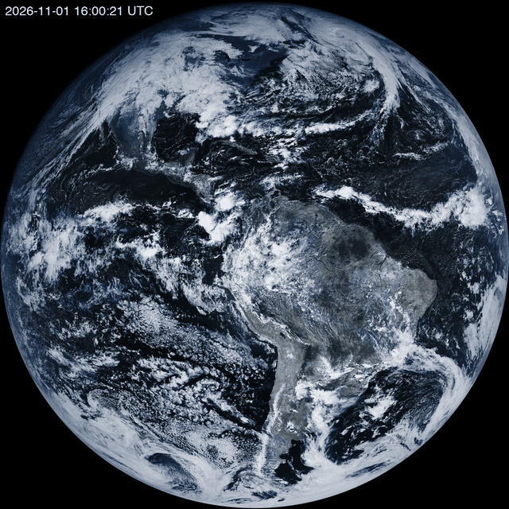
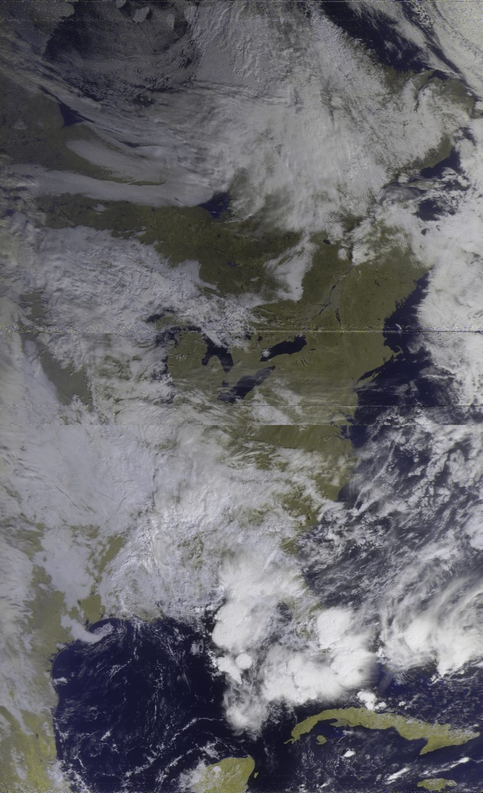
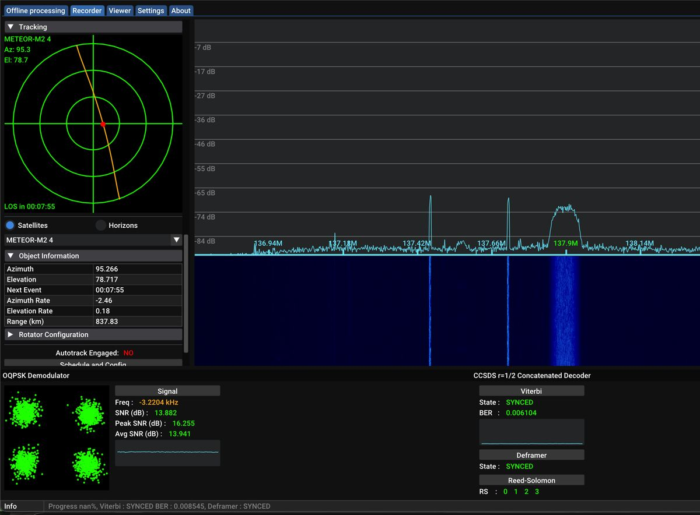

# satellite imagery 🛰️

My personal archive of satellite imagery, mostly from METEOR-M2 LRPT satellite passes and NOAA GOES-19 geostationary HRIT satellites.

**Everything lives at [sat.vincebel.net](https://sat.vincebel.net):** every pass, complete and unfiltered, including all composites, EMWIN weather data, and text products. This repo holds the code and a few small previews.

<figure>
  <a href="https://sat.vincebel.net/misc/nov1-2026.gif"></a>
  <figcaption>Captured 2026-11-01. Satellite: GOES-19, Full Disk false color time-lapse over HRIT</figcaption>
</figure>

<figure>
  <a href="https://sat.vincebel.net/meteor-hrpt/2026-11-01/2026-11-01_14-55_meteor_hrpt_1.7GHz/MSU-MR/msu_mr_rgb_AVHRR_221_False_Color_corrected.png"></a>
  <figcaption>Captured 2026-11-01. Satellite: METEOR-M2-3, HRPT on 1.7 GHz, AVHRR 221 false color</figcaption>
</figure>

## About LRPT
LRPT - [Low Rate Picture Transmission](https://en.wikipedia.org/wiki/Low-rate_picture_transmission)

[Beginner's guide](https://blog.metislair.com/docs/Radio/Beginners%20guide%20to%20weather%20satellite%20reception.html#preamble) (great resource)

## My Setup

- **Receiver**: [RTL-SDR Blog V4](https://www.rtl-sdr.com/about-rtl-sdr/)
- **Antenna**: V-dipole, backyard deployment
- **Software**: [SatDump](https://www.satdump.org/), [gpredict](https://oz9aec.dk/gpredict/)
- **Frequency**: 137.9 MHz
- **Typical gain**: 40 dB (low elevation passes: 44 - 48 dB)

[](https://sat.vincebel.net/misc/satdump-preview.png)

SatDump software shown during peak elevation (78°), capturing LRPT on 137.9 MHz. Decoder pipeline at bottom indicates synced status.

## Archive Layout

The archive at [sat.vincebel.net](https://sat.vincebel.net) is organized by source, then by UTC date, then by pass:

```
goes19/                               # GOES HRIT passes (also include GOES-18 and NWS products)
  2026-11-01/
    2026-11-01_15-47_goes_hrit_1.6941GHz/
      IMAGES/                         # Every composite, per satellite, sector, and timestamp
      EMWIN/                          # Weather bulletins and radar images
      L2/
      Admin Messages/
meteor-lrpt/                          # METEOR LRPT passes
  2026-05-09/
    2026-05-09_20-06_meteor_m2-x_lrpt_137.9MHz/
meteor-hrpt/                          # METEOR HRPT passes
  2026-11-01/
    2026-11-01_14-55_meteor_hrpt_1.7GHz/
elektro/                              # Elektro-L passes
misc/                                 # Time-lapses and setup photos
```

## Repository Structure

```
assets/                               # Small preview images for this README
sync-passes.sh                        # Uploads SatDump passes to the file server
goes_timelapse.py                     # Stitches GOES HRIT frames into a time-lapse GIF
blackrow-analysis.py                  # Identifies black row clusters in an image and maps them to elapsed pass time
```

## Scripts

### `sync-passes.sh`

Uploads every pass from SatDump's output to the file server, keeping everything except `.DS_Store` files. Run it after a pass has decoded:

```bash
./sync-passes.sh                # Sync ~/Documents/live_output
./sync-passes.sh -n             # Dry run: show what would be sent
./sync-passes.sh /other/output  # Sync a different folder
```

It is safe to re-run: files already on the server are never overwritten or deleted, so only new files are sent. Passes written to in the last 10 minutes are skipped until SatDump has finished. To support a new satellite, add a line to `source_for_pass` at the top of the script.

### `goes_timelapse.py`

Builds a time-lapse GIF from GOES-19 HRIT false color frames, in chronological order with a UTC timestamp on each frame. Point it at a sector folder.

```bash
python3 goes_timelapse.py ~/Documents/live_output/"2026-11-01_15-47_goes_hrit_1.6941 GHz/IMAGES/GOES-19/Full Disk" -o earth.gif --width 1200 --fps 6
```

### `blackrow-analysis.py`

Scans a decoded image for black row clusters and reports their position in elapsed time from AOS. Useful for correlating dropout artifacts with pass elevation and diagnosing causes (multipath nulls, low SNR segments, deframer hiccups).

```bash
python3 blackrow-analysis.py path/to/msu_mr_rgb_MSA_corrected.png
```

## Pass Log (incomplete)

| Date | Time (UTC) | Mode | Satellite | Max El | Direction | Peak SNR | Notes |
|------|------------|------|-----------|--------|-----------|----------|-------|
| 2026-11-01 | 15:47 – 00:24 | HRIT | GOES-19, GOES-18 | — | — | — | ~8.5 hour session. 26 GOES-19 Full Disk frames plus Mesoscale 1/2. Source of the time-lapse above |
| 2026-11-01 | 14:55 | HRPT | METEOR-M2-3 | — | — | — | First HRPT pass. All 6 MSU-MR channels plus MTVZA. Image at the top |
| 2026-10-24 | 19:47 | LRPT | METEOR-M2-4 | — | — | — | Clean pass, Great Lakes clear |
| 2026-07-18 | 10:44 – 16:07 | HRIT | GOES-19, GOES-18 | — | — | — | First HRIT session. 14 GOES-19 Full Disk frames plus Mesoscale 1/2 |
| 2026-05-17 | 15:03 | LRPT | METEOR-M2-3 | 78.53° | Southbound | 17.025 | New v2 V-dipole antenna, at a park with more horizon. Basically a perfect pass |
| 2026-05-16 | 19:29 | LRPT | METEOR-M2-4 | — | — | — | Top of image lost, rest clean |
| 2026-05-15 | 15:41 | LRPT | METEOR-M2-3 | — | — | — | Bottom third lost to dropouts |
| 2026-05-14 | 14:29 | LRPT | METEOR-M2-3 | — | — | — | Good, two dropout bands |
| 2026-05-11 | 21:25 | LRPT | METEOR-M2-4 | 11.8° | Northbound | 7.47 | First with DIY V-dipole antenna. Surprisingly decent for 11.8 elevation |
| 2026-05-11 | 19:39 | LRPT | METEOR-M2-4 | 87.44° | Northbound | 16.364 | Best one to date. Near-perfect elevation |
| 2026-05-11 | 15:32 | LRPT | METEOR-M2-3 | 47.51° | — | — | Average |
| 2026-05-09 | 20:06 | LRPT | METEOR-M2-4 | 38° | Northbound | 13.4 dB | - |
| 2026-05-02 | 19:33 | LRPT | METEOR-M2-4 | 78° | — | — | First great image |
| 2026-04-26 | 14:55 | LRPT | METEOR-M2-3 | — | — | — | Short strip with heavy dropouts |
