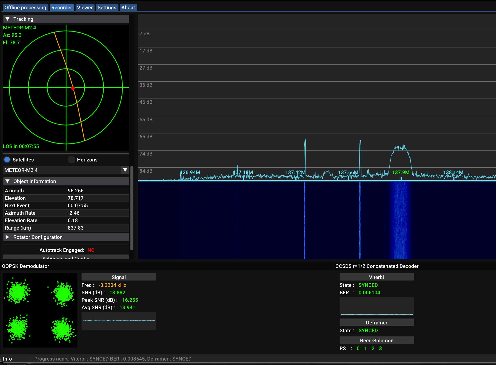

# satellite imagery 🛰️

My personal archive of satellite imagery, mostly from METEOR-M2 LRPT satellite passes and NOAA GOES-19 geostationary HRIT satellites.

<figure>
  
  <figcaption>Captured 2026-11-01. Satellite: GOES-19, Full Disk false color time-lapse over HRIT</figcaption>
</figure>

<figure>
  <a href="data/2026-11-01_14-55_meteor_hrpt_1.7%20GHz/MSU-MR/msu_mr_rgb_AVHRR_221_False_Color_corrected.png"></a>
  <figcaption>Captured 2026-11-01. Satellite: METEOR-M2-3, HRPT on 1.7 GHz, AVHRR 221 false color</figcaption>
</figure>

## About LRPT
LRPT - [Low Rate Picture Transmission](https://en.wikipedia.org/wiki/Low-rate_picture_transmission)

[Beginner's guide](https://blog.metislair.com/docs/Radio/Beginners%20guide%20to%20weather%20satellite%20reception.html#preamble) (great resource)

## My Setup

- **Receiver**: [RTL-SDR Blog V4](https://www.rtl-sdr.com/about-rtl-sdr/)
- **Antenna**: V-dipole, backyard deployment
- **Software**: [SatDump](https://www.satdump.org/), [gpredict](https://oz9aec.dk/gpredict/)
- **Frequency**: 137.9 MHz
- **Typical gain**: 40 dB (low elevation passes: 44 - 48 dB)



SatDump software shown during peak elevation (78°), capturing LRPT on 137.9 MHz. Decoder pipeline at bottom indicates synced status.

## Repository Structure

```
data/
  2026-05-09_20-06_meteor_m2-x_lrpt_137.9 MHz/
    dataset.json                      # Satellite name, timestamp, metadata
    telemetry.json                    # Satellite housekeeping (channel modes, instrument status)
    MSU-MR/
      msu_mr_rgb_MSA_corrected.png    # Best composite image
      MSU-MR-1.png                    # Channel 1 (visible)
      MSU-MR-2.png                    # Channel 2 (visible)
      MSU-MR-3.png                    # Channel 3 (near-infrared)
  2026-11-01_14-55_meteor_hrpt_1.7 GHz/
    dataset.json                      # Satellite name, timestamp, metadata
    MSU-MR/
      telemetry.json                  # HRPT keeps telemetry under MSU-MR
      msu_mr_rgb_MSA_corrected.png    # Best composite image
      MSU-MR-1.png ... MSU-MR-6.png   # Channels 1-6
    MTVZA/
      mtvza_rgb_Microwave_Airmass.png # Microwave composite
  2026-11-01_15-47_goes_hrit_1.6941 GHz/
    IMAGES/GOES-19/Full Disk/
      2026-11-01_18-00-20/
        abi_rgb_ABI_False_Color.png   # One false color frame per timestamp
pull-data-lrpt.sh                     # Copies key LRPT files from SatDump live_output into data/
pull-data-hrpt.sh                     # Copies key HRPT files from SatDump live_output into data/
pull-data-hrit.sh                     # Copies HRIT false color frames from SatDump live_output into data/
goes_timelapse.py                     # Stitches GOES HRIT frames into a time-lapse GIF
blackrow-analysis.py                  # Identifies black row clusters in an image and maps them to elapsed pass time
```

## Scripts

### `pull-data-lrpt.sh`, `pull-data-hrpt.sh`, `pull-data-hrit.sh`

Copies the key files from a SatDump output directory into `data/`, one script per downlink. Skips passes that already exist — will not overwrite existing passes. Passes with no decoded images are skipped.

```bash
./pull-data-lrpt.sh ~/Documents/live_output
./pull-data-hrpt.sh ~/Documents/live_output
./pull-data-hrit.sh ~/Documents/live_output
```

The HRIT script only keeps `abi_rgb_ABI_False_Color.png` from each frame (~37 MB per Full Disk frame). Add more filenames to the `KEEP` array at the top of the script to pull other composites.

### `goes_timelapse.py`

Builds a time-lapse GIF from GOES-19 HRIT false color frames, in chronological order with a UTC timestamp on each frame. Point it at a sector folder.

```bash
python3 goes_timelapse.py "data/2026-11-01_15-47_goes_hrit_1.6941 GHz/IMAGES/GOES-19/Full Disk" -o earth.gif --width 1200 --fps 6
```

### `blackrow-analysis.py`

Scans a decoded image for black row clusters and reports their position in elapsed time from AOS. Useful for correlating dropout artifacts with pass elevation and diagnosing causes (multipath nulls, low SNR segments, deframer hiccups).

```bash
python3 blackrow-analysis.py data/2026-05-09_20-06_meteor_m2-x_lrpt_137.9\ MHz/MSU-MR/msu_mr_rgb_MSA_corrected.png
```

## Pass Log (incomplete)

| Date | Time (UTC) | Mode | Satellite | Max El | Direction | Peak SNR | Notes |
|------|------------|------|-----------|--------|-----------|----------|-------|
| 2026-11-01 | 15:47 – 00:24 | HRIT | GOES-19, GOES-18 | — | — | — | ~8.5 hour session. 26 GOES-19 Full Disk frames plus Mesoscale 1/2. Source of the time-lapse above |
| 2026-11-01 | 14:55 | HRPT | METEOR-M2-3 | — | — | — | First HRPT pass. All 6 MSU-MR channels plus MTVZA. Image at the top |
| 2026-10-24 | 19:47 | LRPT | METEOR-M2-4 | — | — | — | Clean pass, Great Lakes clear |
| 2026-07-18 | 10:44 – 16:07 | HRIT | GOES-19, GOES-18 | — | — | — | First HRIT session. 14 GOES-19 Full Disk frames plus Mesoscale 1/2 |
| 2026-05-17 | 15:03 | LRPT | METEOR-M2-3 | 78.53° | Southbound | 17.025 | New v2 V-dipole antenna, at a park with more horizon. Basically a perfect pass |
| 2026-05-16 | 19:29 | LRPT | METEOR-M2-4 | — | — | — | Top of image lost, rest clean |
| 2026-05-15 | 15:41 | LRPT | METEOR-M2-3 | — | — | — | Bottom third lost to dropouts |
| 2026-05-14 | 14:29 | LRPT | METEOR-M2-3 | — | — | — | Good, two dropout bands |
| 2026-05-11 | 21:25 | LRPT | METEOR-M2-4 | 11.8° | Northbound | 7.47 | First with DIY V-dipole antenna. Surprisingly decent for 11.8 elevation |
| 2026-05-11 | 19:39 | LRPT | METEOR-M2-4 | 87.44° | Northbound | 16.364 | Best one to date. Near-perfect elevation |
| 2026-05-11 | 15:32 | LRPT | METEOR-M2-3 | 47.51° | — | — | Average |
| 2026-05-09 | 20:06 | LRPT | METEOR-M2-4 | 38° | Northbound | 13.4 dB | - |
| 2026-05-02 | 19:33 | LRPT | METEOR-M2-4 | 78° | — | — | First great image |
| 2026-04-26 | 14:55 | LRPT | METEOR-M2-3 | — | — | — | Short strip with heavy dropouts |
